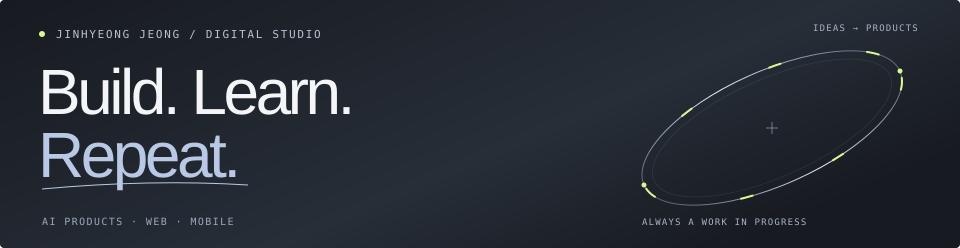

### 정진형 · Jinhyeong Jeong

AI 제품과 웹·모바일 서비스를 만들고, 피드백과 데이터로 개선합니다. 
경희대학교 소프트웨어융합학과 · 데이터사이언스 트랙

[**Portfolio ↗**](https://jinhyeong-studio.jinhyeong9568-663.workers.dev/) &nbsp; / &nbsp; [Journal](https://jinhyeong-studio.jinhyeong9568-663.workers.dev/blog) &nbsp; / &nbsp; [Email](mailto:jinhyeong9568@gmail.com)

---

#### SELECTED WORK

- **[PromptLab Extension](https://github.com/JH-9568/PromptLab-Extension)** — AI 채팅 입력창에서 바로 쓰는 프롬프트 개선 도구 · [Chrome 웹 스토어 ↗](https://chromewebstore.google.com/detail/promptlab-extension/cccaddmgliiiepjcgaekieijbidlpljg)
- **[부여ON](https://jinhyeong-studio.jinhyeong9568-663.workers.dev/projects/buyeo-on)** — 디지털 군민증과 현장 퀴즈로 시작하는 부여 여행 · [App Store ↗](https://apps.apple.com/kr/app/id6807093401)
- **[QuizHub](https://jinhyeong-studio.jinhyeong9568-663.workers.dev/projects/quizhub)** — 강의 자료를 문제집으로, 시험처럼 풀고 함께 공유하는 공부
- **[Mr.Park](https://github.com/yumina0616/ai-championship-2026)** — 사람과 AI의 주행을 비교하는 3D 주차 시뮬레이터
- **[찍어줄게](https://jinhyeong-studio.jinhyeong9568-663.workers.dev/projects/jjigeojulge)** — 구도 안내·자동 촬영·사진 선별을 돕는 온디바이스 iPhone 앱 · 출시 준비
- **[Moods](https://github.com/JH-9568/Moods)** — 공부한 시간에 공간과 감정을 더하는 기록 앱

<b>More projects</b> — AI tools, apps & experiments

| 프로젝트 | 만들고 실험하는 것 |
| --- | --- |
| [Rigmetry](https://github.com/JH-9568/rigmetry) | 에이전트 하네스의 실행 기록·무호출 재생·통제된 비교 |
| [OpenBrief](https://github.com/JH-9568/OpenBrief) | 협업 도구의 맥락을 모아 근거와 함께 검토하는 브리프 |
| [PromptLab](https://github.com/JH-9568/PromptLab) | 프롬프트 실험·버전 관리·팀 공유를 연결한 웹 플랫폼 |
| [TeamApp](https://github.com/JH-9568/TeamApp) | 회의 음성을 실시간 기록하고 요약·할 일로 정리하는 앱 |
| [Ollama LLM Service](https://github.com/JH-9568/docker-to-k8s-ollama-service) | Redis 작업 큐 기반 LLM 추론과 Docker → Kubernetes 배포 실험 |
| [Flex](https://github.com/JH-9568/khuthon-app) | 외식·집밥 비용 비교와 게임형 보상을 연결한 해커톤 앱 |
| [GuineaGrow](https://github.com/JH-9568/guinea-grow-practice) | 퀴즈 학습을 기니피그 성장으로 표현한 웹 MVP |

---

WORKING WITH &nbsp; TypeScript · React / Next.js · Flutter · SwiftUI · Python / FastAPI
